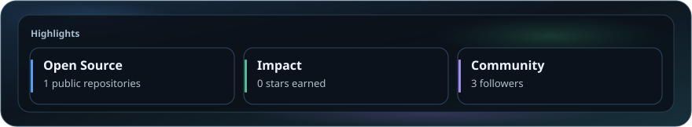

<h1 align="center">Hey 👨‍💻 I’m ashwwinadn</h1>

  

## 📌 About Me

I work across full-stack development, cloud infrastructure, and developer tooling.

## 📊 GitHub Stats & Trophies

  
  

  

  

  

## 🛠️ Languages & Tools

> ### Programming Languages

  
  
  
  
  
  

> ### Frontend

  
  
  
  
  
  

> ### Backend

  
  

> ### Database

  
  
  
  
  

> ### DevOps & Cloud

  
  
  
  
  
  

> ### Tools

  
  
  
  
  
  

## 🔗 Connect with Me

  <a href="https://github.com/AshwwinADn">GitHub</a>

  

  ashwwinadn · <a href="https://www.gitskins.com/templates/community-creative-dev-rt3x">creative dev</a> template by <a href="https://github.com/himanshu201031">@himanshu201031</a> · live cards by <a href="https://www.gitskins.com/">GitSkins</a>

